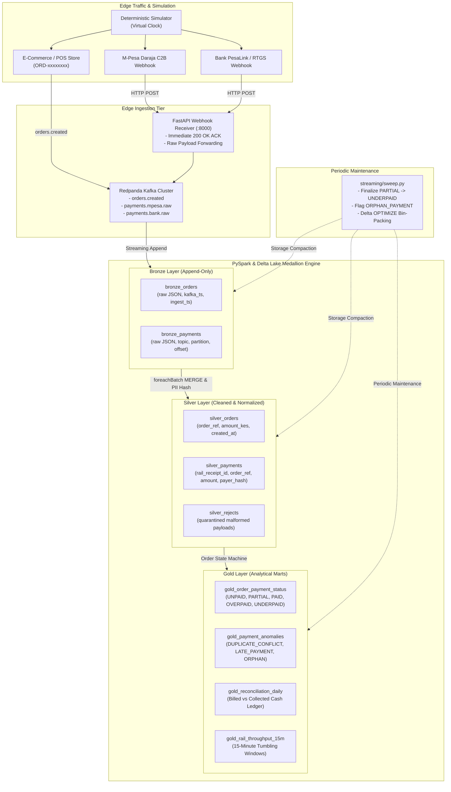
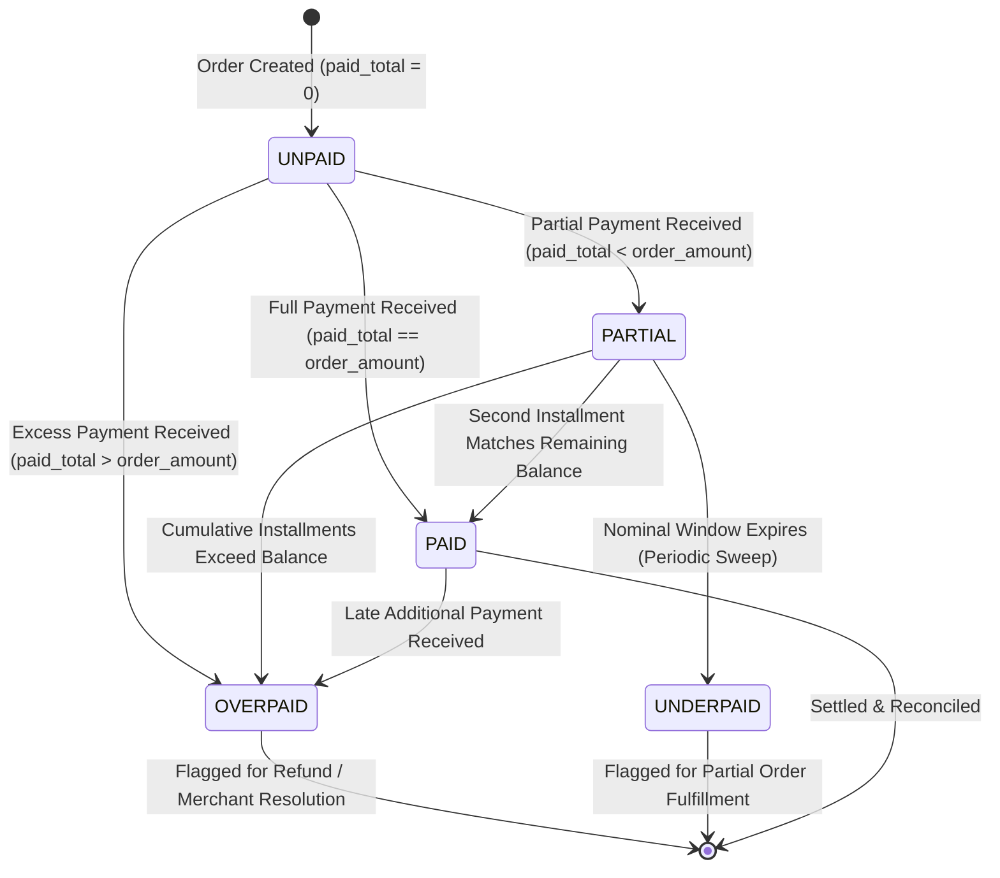

# Rekon: Streaming Payment Reconciliation Engine

[](https://github.com/paulakelo/rekon/actions/workflows/ci.yml)
[](LICENSE)
[](pyproject.toml)
[](pyproject.toml)
[](pyproject.toml)
[](docker-compose.yml)

A local, zero-cost ($0) event-driven streaming payment reconciliation lakehouse built with **Kafka (Redpanda KRaft)**, **PySpark 3.5.1 Structured Streaming**, and **Delta Lake 3.2.0** on an 8 GB developer laptop.

---

## 1. Problem Statement

A Kenyan SME selling online accepts payments across multiple digital rails:
- **M-Pesa Paybill / Till** (Safaricom Daraja C2B confirmation webhooks)
- **Direct Bank Transfers / RTGS / PesaLink**
- **Mobile Wallets & Split Cash**

At settlement cutoff, finance teams must answer:
- *Which orders were actually paid in full?*
- *Which payments are duplicates from upstream network retries?*
- *Which payments arrived with no matching order (orphans)?*
- *Which customers underpaid, overpaid, or paid in split installments across days?*

In practice, webhooks arrive **duplicated, late, out-of-order, or inverted** (payment landing before the order is created). Naive batch pipelines produce incorrect revenue totals and double-count receipts.

**Rekon** solves this via:
1. **Resilient Edge Ingestion**: Non-blocking FastAPI receiver pushing raw byte streams directly to Kafka without edge rejection (zero-loss principle).
2. **Medallion Lakehouse Architecture**: Bronze $\rightarrow$ Silver $\rightarrow$ Gold with Delta Lake ACID transactions.
3. **Strict Deduplication & PII Sanitation**: Delta `MERGE` on `(rail, rail_receipt_id)` prevents duplicates across restarts; salted SHA-256 hashes protect customer PII.
4. **Reconciled Order State Machine**: Handles multi-installment splits, overpayments, underpayments, and late settlements deterministically.
5. **Periodic Sweep & Compaction**: Finalizes expired payment windows and compacts small Parquet files using Delta `OPTIMIZE`.
6. **Bit-for-Bit Replay Idempotency**: Wiping derived layers and replaying from Bronze reproduces bit-identical Gold ledgers.

---

## 2. Business Questions Answered

| ID | Persona | Business Question | Reconciled Target Mart |
|:---|:---|:---|:---|
| **Q-1** | **Finance Analyst** | What is the payment status of every order right now? | `data/delta/gold_order_payment_status` |
| **Q-2** | **Finance Analyst** | Which payments or orders look suspicious, and why? | `data/delta/gold_payment_anomalies` |
| **Q-3** | **Operations Lead** | How many payments per rail per 15 minutes, and how late are they? | `data/delta/gold_rail_throughput_15m` |
| **Q-4** | **CFO / Leadership** | What was collected versus billed per day? | `data/delta/gold_reconciliation_daily` |

---

## 3. Architecture & Data Flow



---

## 4. Medallion Lakehouse Storage Specs

| Layer | Delta Table | Primary Key | Key Columns | Write Pattern | Key Responsibility |
|:---|:---|:---|:---|:---|:---|
| **Bronze** | `bronze_orders` | Synthetic UUID | `raw_payload`, `kafka_timestamp`, `ingest_timestamp` | Append-Only | Raw payload preservation. |
| **Bronze** | `bronze_payments` | Synthetic UUID | `raw_payload`, `rail`, `topic`, `partition`, `offset` | Append-Only | Zero-loss edge capture. |
| **Silver** | `silver_orders` | `order_ref` | `order_ref`, `shop_id`, `amount_kes`, `created_at` | Delta `MERGE` | Normalized orders. |
| **Silver** | `silver_payments` | `(rail, rail_receipt_id)` | `rail`, `rail_receipt_id`, `order_ref`, `amount_kes`, `paid_at`, `payer_identifier_hash` | Delta `MERGE` | Idempotent deduplication & salted SHA-256 PII masking. |
| **Silver** | `silver_rejects` | Synthetic UUID | `raw_payload`, `rail`, `rejection_reason`, `rejected_at` | Append-Only | Dead-letter queue for malformed JSON. |
| **Gold** | `gold_order_payment_status` | `order_ref` | `order_ref`, `order_amount_kes`, `paid_total_kes`, `payment_count`, `status` | Delta `MERGE` | Per-order reconciled status (`UNPAID`, `PARTIAL`, `PAID`, `OVERPAID`, `UNDERPAID`). |
| **Gold** | `gold_payment_anomalies` | `anomaly_id` | `anomaly_type`, `rail`, `order_ref`, `rail_receipt_id`, `details`, `detected_at` | Delta `MERGE` | Operational exceptions with reason codes. |
| **Gold** | `gold_reconciliation_daily` | `recon_date` | `recon_date`, `billed_amount_kes`, `collected_amount_kes`, status breakdown | Overwrite / MERGE | CFO daily billed vs. collected ledger. |
| **Gold** | `gold_rail_throughput_15m` | `(rail, window_start)` | `rail`, `window_start`, `window_end`, `transaction_count`, `total_amount_kes` | Delta `MERGE` | 15-minute event-time velocity telemetry. |

---

## 5. Order Payment Status State Machine



---

## 6. Chaos Scenarios & Resilience Matrix

Rekon is verified against 11 real-world chaos conditions in `tests/scenarios/test_chaos.py`:

| ID | Scenario | Condition Injected | Pipeline Handling & Expected Behavior | Target Table Verified |
|:---|:---|:---|:---|:---|
| **C1** | Happy Path | On-time, single payment | Settles immediately; status transitions from `UNPAID` to `PAID`. | `gold_order_payment_status` (`PAID`) |
| **C2** | Duplicate Redelivery | Same receipt delivered 3 times | Delta MERGE idempotency; 1 Silver record created; no anomaly. | `silver_payments` (1 row) |
| **C3** | Amount Conflict | Same receipt redelivered with different amount | First amount kept; `DUPLICATE_RECEIPT_CONFLICT` anomaly recorded. | `gold_payment_anomalies` |
| **C4** | Late Payment | Payment arrives 55 hours after order (>48h window) | Matched to order; status `PAID`; flagged with `LATE_PAYMENT`. | `gold_payment_anomalies` |
| **C5** | Orphan Payment | Payment arrives with unknown order reference | Preserved in Silver; quarantined in anomalies ledger as `ORPHAN_PAYMENT`. | `gold_payment_anomalies` |
| **C6** | Split Payment | Order paid via 2 distinct installments (40% + 60%) | First payment yields `PARTIAL`; second yields `PAID` with count=2. | `gold_order_payment_status` (`PAID`) |
| **C7** | Underpayment Sweep | Order paid 60%; remainder abandoned | `PARTIAL` during window; finalized as `UNDERPAID` by sweep job. | `gold_order_payment_status` (`UNDERPAID`) |
| **C8** | Overpayment | Customer overpays order by 30% | Transitions to `OVERPAID`; excess delta logged for merchant refund. | `gold_payment_anomalies` (`OVERPAID`) |
| **C9** | Malformed Payload | Corrupted JSON or unclosed string | Captured raw in Bronze; routed to `silver_rejects` with reason code. | `silver_rejects` |
| **C10**| Worker Crash | Spark restarted across multiple batch passes | Recovers cleanly from Delta ACID checkpoint; zero loss, zero dupes. | Delta Lake tables |
| **C11**| Cold Replay | Silver & Gold wiped; recomputed from Bronze | Bit-identical Gold status rows and totals regenerated (`verify_replay`). | Row-for-row equality match |

---

## 7. Sample Executive Report (`make report`)

Running `make report` queries the Gold Delta tables and renders the financial ledger directly in your terminal:

```text
==========================================================================================
 📊 REKON: PAYMENT RECONCILIATION & ANOMALIES REPORT
==========================================================================================

--- [Q-4] DAILY RECONCILIATION LEDGER (BILLED VS COLLECTED) ---
 Recon Date         : 2026-10-19
 Billed Revenue     : KES 161,332.57 (26 orders)
 Collected Cash     : KES 156,224.89 (96.8% settlement rate)
 Paid Orders        : 23
 Partial Orders     : 0
 Underpaid Orders   : 1
 Overpaid Orders    : 1
 Unpaid Orders      : 1

--- [Q-1] ORDER PAYMENT STATUS (SAMPLE AUDIT TRAIL) ---
Order Ref       Shop ID                Billed KES   Paid KES     Count  Status      
-------------------------------------------------------------------------------------
ORD-00000003    SHOP-003-KILIMANI         9298.13    9298.13     2   PAID        
ORD-00000004    SHOP-002-WESTLANDS        7524.48    5267.14     1   UNDERPAID   
ORD-00000005    SHOP-001-NAIROBI-CBD       712.04     890.05     1   OVERPAID    
ORD-00000006    SHOP-004-MOMBASA-TOW      3176.83    3176.83     1   PAID        
ORD-00000008    SHOP-007-ELDORET-MAI      3028.35       0.00     0   UNPAID      

--- [Q-2] DETECTED PAYMENT ANOMALIES WITH REASON CODES ---
Anomaly ID     Anomaly Type           Rail     Order Ref       Details
------------------------------------------------------------------------------------------
ANO-OVP-0001   OVERPAID               ALL      ORD-00000005    {"order_amount": 712.04, "paid_total": 890.05}
ANO-LAT-0002   LATE_PAYMENT           ALL      ORD-00000006    {"paid_at": "2026-10-20 13:50:00", "delay_hours": 55.0}
ANO-ORP-0003   ORPHAN_PAYMENT         mpesa    ORD-99999999    {"amount_kes": 1850.0, "paid_at": "2026-10-20 19:10:00"}
ANO-UND-0001   UNDERPAID              ALL      ORD-00000004    {"order_amount": 7524.48, "paid_total": 5267.14}

--- [Q-3] RAIL THROUGHPUT (15-MINUTE EVENT-TIME WINDOWS) ---
Rail       Window Start         Window End           Tx Count   Total KES
---------------------------------------------------------------------------
bank       2026-10-18 09:30:00  2026-10-18 09:45:00  1              890.05
mpesa      2026-10-18 08:00:00  2026-10-18 08:15:00  2             3979.32
mpesa      2026-10-20 15:00:00  2026-10-20 15:15:00  2            13571.99

--- [FR-11] DEAD-LETTER REJECTS: 1 malformed payloads quarantined in silver_rejects ---
==========================================================================================
```

---

## 8. Quickstart & Developer Workflow

### Prerequisites
- Linux or macOS
- Python 3.11 (`uv` or `python3.11-venv`)
- Eclipse Temurin Java 11 JDK (required for PySpark 3.5 & Delta Lake 3.2)
- Docker & Docker Compose

### Commands

```bash
# 1. Setup virtual environment and dependencies
make setup

# 2. Launch Docker services (Redpanda Kafka & create topics)
make up

# 3. Run full end-to-end simulated reconciliation demo with chaos
make demo

# 4. View executive reconciliation ledger and anomalies report
make report

# 5. Run periodic sweep (finalizes expired windows & compacts Delta tables)
make sweep

# 6. Verify cold disaster recovery and bit-for-bit replay determinism
make replay

# 7. Run full unit and 11-scenario chaos test suite
make test

# 8. Clean up containers and local storage
make down
```

---

## 9. Documentation Index

### Milestone Build Records
- [Milestone 1: Environment, Docker Compose & Scaffolding](docs/milestones/M1_ENVIRONMENT_AND_SCAFFOLDING.md)
- [Milestone 2: FastAPI Ingestion Receiver & Kafka Producer](docs/milestones/M2_FASTAPI_EDGE_RECEIVER_AND_KAFKA.md)
- [Milestone 3: Deterministic Event Simulator & Chaos Suite](docs/milestones/M3_DETERMINISTIC_EVENT_SIMULATOR_AND_CHAOS.md)
- [Milestone 4: Bronze Streaming Append](docs/milestones/M4_BRONZE_STREAMING_APPEND.md)
- [Milestone 5: Silver Normalization, Deduplication & Rejects](docs/milestones/M5_SILVER_NORMALIZATION_DEDUPE_AND_REJECTS.md)
- [Milestone 6: Gold Reconciliation & Anomaly Engine](docs/milestones/M6_GOLD_RECONCILIATION_AND_ANOMALY_ENGINE.md)
- [Milestone 7: Sweep Job, Observability & Chaos Test Suite](docs/milestones/M7_SWEEP_JOB_OBSERVABILITY_AND_CHAOS.md)
- [Milestone 8: CI Pipeline, Documentation & Project Showcase](docs/milestones/M8_CI_PIPELINE_AND_PROJECT_SHOWCASE.md)

### Architecture Decision Records (ADRs)
- [ADR 0001: Delta MERGE vs Watermark dropDuplicates](docs/decisions/0001-delta-merge-vs-watermark-dedupe.md)
- [ADR 0002: Virtual Clock vs Wall Clock](docs/decisions/0002-event-time-vs-wall-clock.md)
- [ADR 0003: Bronze Raw Payload Preservation and Replay](docs/decisions/0003-bronze-raw-preservation-and-replay.md)
- [ADR 0004: FastAPI Edge Receiver & Zero-Loss Ingestion](docs/decisions/0004-fastapi-edge-receiver-and-zero-loss-ingestion.md)
- [ADR 0005: Salted SHA-256 PII Masking at Silver Boundary](docs/decisions/0005-salted-sha256-pii-masking-at-silver-boundary.md)
- [ADR 0006: Checkpointed Delta Structured Streaming with AvailableNow](docs/decisions/0006-checkpointed-delta-structured-streaming-with-availablenow.md)
- [ADR 0007: Periodic Sweep Finalization, Orphan Detection, and Storage Compaction](docs/decisions/0007-periodic-sweep-finalization-and-storage-compaction.md)

---

## 10. Connected Ecosystem (dukastack)

Rekon borrows architectural principles from **dukastack**:
- **Shared Reference Format**: Both systems use `ORD-xxxxxxxx` order references, modeling invoice creation in dukastack and downstream payment settlement in Rekon.
- **$0 Local Stack**: Full enterprise lakehouse capabilities operating on an 8 GB developer workstation with zero cloud subscriptions.
- **Detailed Build Process**: Granular architectural documentation, ADRs, and frequent commits documenting every milestone.
