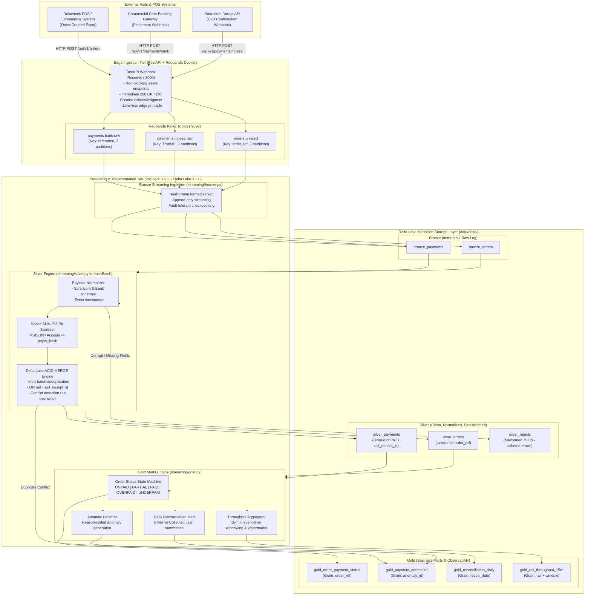

# Architecture & Lakehouse Design

## 1. Executive Summary

**Rekon** is an event-driven, production-grade payment reconciliation lakehouse designed for digital commerce businesses operating across emerging markets (specifically Kenya and broader East Africa). It continuously reconciles real-time webhook streams from mobile money (Safaricom Daraja C2B confirmation API) and commercial banking settlement gateways against point-of-sale (POS) and ecommerce order records.

The pipeline implements the **Medallion Architecture (Bronze -> Silver -> Gold)** using **PySpark Structured Streaming** and **Delta Lake**, running entirely on a **$0 local stack** powered by Redpanda (Kafka-compatible broker in Docker) on an 8 GB developer laptop.

---

## 2. End-to-End System Architecture



---

## 3. Webhook Ingestion & Decoupled Durability

```mermaid
sequenceDiagram
    autonumber
    actor Gateway as External Payment Gateway (Safaricom / Bank)
    participant Receiver as FastAPI Receiver (:8000)
    participant Producer as Kafka Producer (kafka-python-ng)
    participant Redpanda as Redpanda Broker (Topic Log)
    participant PySpark as PySpark Structured Streaming

    Gateway->>Receiver: POST /api/v1/payments/mpesa (HTTP Callback)
    activate Receiver
    Note over Receiver: Read raw body bytes;<br/>Do NOT parse business rules
    Receiver->>Producer: publish_raw_event(topic, raw_payload, key)
    activate Producer
    Producer->>Redpanda: Append to payments.mpesa.raw
    Redpanda-->>Producer: Broker ACK (Offset committed)
    deactivate Producer
    Receiver-->>Gateway: 200 OK {"ResultCode": 0, "ResultDesc": "Accepted"}
    deactivate Receiver
    Note over Gateway: Gateway satisfied in < 15ms;<br/>Zero retry storm

    Note over Redpanda,PySpark: Asynchronous Lakehouse Ingestion
    Redpanda->>PySpark: readStream micro-batch
    activate PySpark
    PySpark->>PySpark: Append raw payload + metadata to Bronze Delta
    PySpark-->>Redpanda: Update Kafka consumer offset in checkpoint
    deactivate PySpark
```

---

## 4. Medallion Storage Tier Specifications

### 4.1 Bronze Layer (Immutable Raw Event Log)
- **Tables**:
  - `data/delta/bronze_orders`
  - `data/delta/bronze_payments`
- **Write Pattern**: Streaming append with checkpointing (`.format("delta").outputMode("append")`).
- **Schema Contracts**:
  - `topic` (`StringType`): Source topic (`orders.created`, `payments.mpesa.raw`, `payments.bank.raw`).
  - `partition` (`IntegerType`): Kafka partition ID (0, 1, 2).
  - `offset` (`IntegerType`): Kafka sequence offset.
  - `kafka_timestamp` (`TimestampType`): Broker commit timestamp.
  - `ingest_timestamp` (`TimestampType`): Micro-batch arrival timestamp (`current_timestamp()`).
  - `raw_payload` (`StringType`): Unparsed, untouched JSON payload string.
- **Key Guarantee**: 100% preservation of incoming bytes. If a parser bug is detected months later, Bronze can be replayed from offset 0 to reconstruct the entire analytical state without re-querying external providers.

---

### 4.2 Silver Layer (Clean, Validated, Deduplicated & Masked)
- **Tables**:
  - `data/delta/silver_orders` (Primary Key: `order_ref`)
  - `data/delta/silver_payments` (Primary Key: `(rail, rail_receipt_id)`)
  - `data/delta/silver_rejects` (Dead-letter store for invalid payloads)
- **Write Pattern**: Structured Streaming `foreachBatch` with Delta Lake ACID `MERGE`.
- **Deduplication Strategy (ADR 0001)**:
  - Intra-batch deduplication via `.dropDuplicates(["rail", "rail_receipt_id"])`.
  - Delta Lake `MERGE`:
    ```sql
    MERGE INTO silver_payments AS target
    USING microbatch_payments AS source
    ON target.rail = source.rail AND target.rail_receipt_id = source.rail_receipt_id
    WHEN NOT MATCHED THEN INSERT *
    ```
- **Duplicate Conflict Protection**:
  - If a receipt ID arrives a second time with a *differing* amount, the initial record is preserved without overwrite, and an anomaly row is dispatched to `gold_payment_anomalies`.
- **PII Sanitation (ADR 0005)**:
  - Phone numbers (`MSISDN`) and bank accounts are sanitized using salted SHA-256 (`hash_payer_identifier`), writing an anonymized 24-character `payer_hash`.
- **Rejects Routing**:
  - Payloads with invalid JSON syntax or missing mandatory fields land in `silver_rejects` with an explicit `reject_reason`.

---

### 4.3 Gold Layer (Analytical Marts & Financial Ledger)
- **Tables**:
  - `data/delta/gold_order_payment_status`: Order reconciliation grain.
    - Status state machine: `UNPAID` $\rightarrow$ `PARTIAL` $\rightarrow$ `PAID` (or `OVERPAID` / `UNDERPAID`).
  - `data/delta/gold_payment_anomalies`: Diagnostic grain.
    - Anomaly codes: `DUPLICATE_CONFLICT`, `ORPHAN_PAYMENT`, `LATE_PAYMENT`, `OVERPAID`, `UNDERPAID`, `MALFORMED_PAYLOAD`.
  - `data/delta/gold_reconciliation_daily`: Executive reporting grain.
    - Aggregates daily billed vs collected cash totals and order counts by status.
  - `data/delta/gold_rail_throughput_15m`: Operational telemetry grain.
    - 15-minute event-time tumbling windows tracking transaction velocity, total cash, and average order value per rail.

---

## 5. Summary of Architecture Decision Records (ADRs)

| ADR | Title | Core Decision |
| :--- | :--- | :--- |
| **ADR 0001** | Delta MERGE vs Watermark dropDuplicates | Persist keys in Delta Lake and merge on `(rail, rail_receipt_id)` to survive late retries and prevent memory leaks. |
| **ADR 0002** | Virtual Clock vs Wall Clock | Forbid wall-clock `now()` in reconciliation logic; use deterministic `VirtualClock` for 100% reproducible replays. |
| **ADR 0003** | Bronze Raw Payload Preservation | Store unparsed UTF-8 strings in Bronze to guarantee zero data loss and enable cold replays. |
| **ADR 0004** | FastAPI Edge Receiver & Zero-Loss Ingestion | Immediate 200 OK edge responses; forward raw payloads directly to Kafka without edge rejection. |
| **ADR 0005** | Salted SHA-256 PII Masking | Salt and hash customer phone numbers and accounts before insertion into `silver_payments`. |
| **ADR 0006** | Checkpointed Delta Structured Streaming | Implement `trigger(availableNow=True)` alongside continuous mode for deterministic CI and batch executions. |
