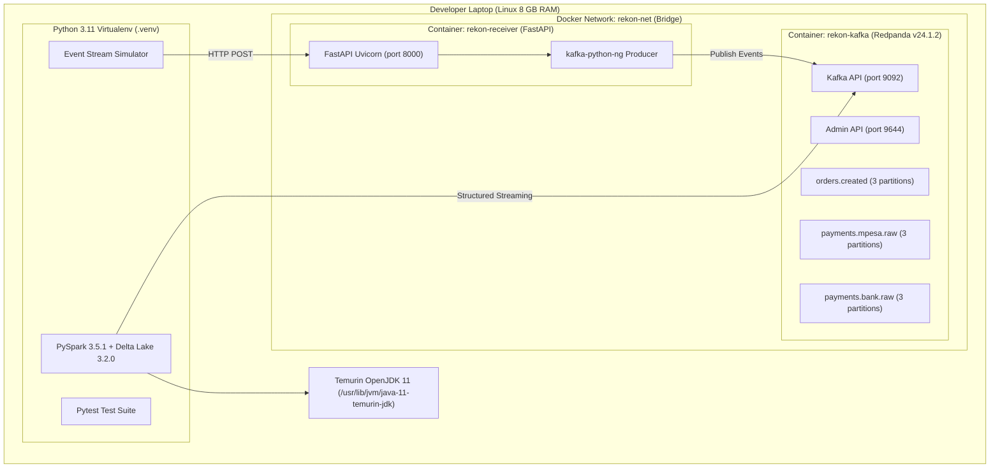

# Milestone 1: Environment, Docker Compose & Local Scaffolding

## 1. Context & Objectives

The goal of **Milestone 1 (M1)** is to establish a rock-solid, reproducible, zero-cost ($0) streaming lakehouse development environment that runs completely locally on an 8 GB laptop without external cloud bills or managed services.

Borrowing directly from the **Dukastack** philosophy:
- **Reproducibility**: A single `docker compose up -d` brings up the entire event streaming backbone.
- **Lightweight Footprint**: Memory capped to prevent laptop thrashing while running PySpark, Kafka, and FastAPI concurrently.
- **Frequent Logical Commits**: Clean, granular git history tracking every component.

---

## 2. Architecture & Component Diagram



---

## 3. Key Architectural Decisions & Trade-Offs

### Decision 1: Redpanda vs. Traditional Apache Kafka + ZooKeeper
- **Choice**: Deployed `docker.redpanda.com/redpandadata/redpanda:v24.1.2` in KRaft mode.
- **Rationale**:
  - Apache Kafka historically required ZooKeeper or a resource-heavy KRaft JVM container consuming 2–3 GB RAM just for idle operation.
  - Redpanda is written in C++, boots in under 1 second, and runs comfortably within a 1 GB RAM allocation (`--memory 1G --reserve-memory 0M`).
  - It exposes a 100% Kafka-compatible wire protocol on port `9092`, allowing all standard Kafka clients (`kafka-python-ng`, `spark-sql-kafka`) to connect without code changes.

### Decision 2: Pinning Python 3.11 with Temurin Java 11
- **Problem**: The host Linux system runs system Python 3.14 and default OpenJDK 25.
  - OpenJDK 25 completely removed `Subject.getSubject`, which causes Apache Spark 3.5.1 JVM execution to crash with `NoSuchMethodError`.
  - Python 3.14 workers fail when communicating with PySpark 3.5 serializer pipes.
- **Solution**:
  - Pinned Python virtual environment to Python 3.11 (`requires-python = ">=3.11,<3.13"`).
  - Implemented `ensure_java_compatibility()` in `streaming/pipeline.py` which dynamically detects Temurin Java 11 (`/usr/lib/jvm/java-11-temurin-jdk`) and sets `JAVA_HOME`.
  - Set `PYSPARK_PYTHON = sys.executable` and `PYSPARK_DRIVER_PYTHON = sys.executable` to guarantee worker-driver version parity.

### Decision 3: Automatic Topic Provisioning & Healthchecks
- Added healthchecks on `rekon-kafka` using `rpk cluster health` with case-insensitive regex parsing (`grep -i 'healthy:.*true'`).
- The receiver service depends on `rekon-kafka` with `condition: service_healthy`, ensuring topics `orders.created`, `payments.mpesa.raw`, and `payments.bank.raw` are ready before the HTTP edge starts accepting traffic.

---

## 4. Build Process Step-by-Step

1. **Repository Setup**: Initialized canonical Git repository with remote tracking `https://github.com/paulakelo/rekon.git`.
2. **Dependency Configuration (`pyproject.toml`)**:
   - Hatchling build backend.
   - Pinned core dependencies: `pyspark>=3.5.0,<3.6.0`, `delta-spark>=3.2.0,<3.3.0`, `fastapi>=0.111.0`, `uvicorn>=0.30.0`, `pydantic>=2.7.0`, `kafka-python-ng>=2.2.0`, `httpx>=0.27.0`.
   - Tool configs for `ruff` (line-length 100) and `pytest`.
3. **Docker Compose Specification (`docker-compose.yml`)**:
   - Configured Redpanda single-node cluster with `--smp 1 --memory 1G`.
   - Added `receiver` container build context targeting `receiver/Dockerfile`.
4. **Make Automation (`Makefile`)**:
   - Targets: `setup`, `up`, `down`, `demo`, `test`, `replay`, `report`, `lint`, `fmt`, `clean`.

---

## 5. Verification & Proof of Done

Running `docker compose up -d` produces healthy services:
```bash
NAME             IMAGE                                               STATUS
rekon-kafka      docker.redpanda.com/redpandadata/redpanda:v24.1.2   Up (healthy)
rekon-receiver   rekon-receiver                                      Up (port 8000)
```

Cluster health check:
```bash
docker compose exec redpanda rpk cluster health
# Output:
# Healthy: true
```
