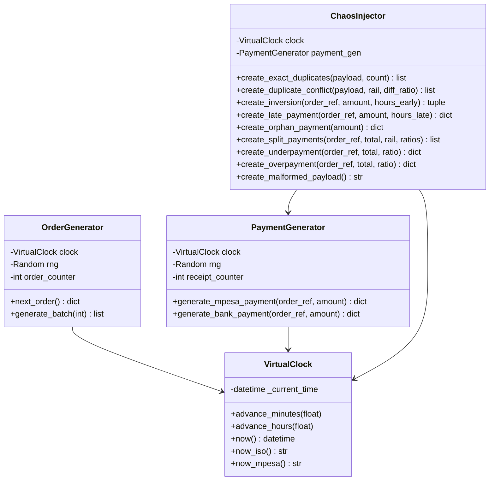
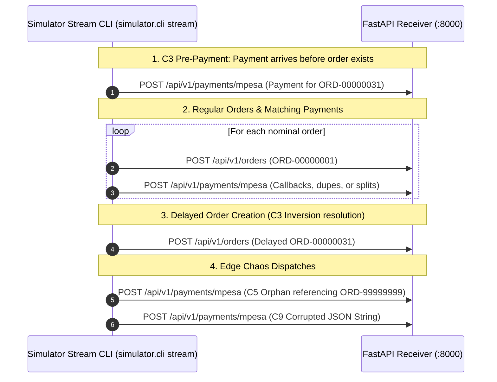

# Milestone 3: Event-Driven Deterministic Simulator & Chaos Suite

## 1. Context & Objectives

To validate a financial reconciliation lakehouse, synthetic data must reflect the messiness of real-world payment networks. Real-world payments do not arrive in neat, 1-to-1 sequential order:
- Aggregators retry notifications (exact duplicates).
- Network jitter causes payments to arrive hours *before* orders are recorded in the central database (inversion).
- Customers pay in installments (split payments).
- Payers enter typos in Paybill account numbers (orphan payments).
- Network proxies truncate JSON bytes (malformed payloads).

**Milestone 3 (M3)** provides a deterministic event simulator that models both nominal transaction behavior and 11 explicit chaos scenarios while guaranteeing 100% bit-for-bit reproducibility.

---

## 2. Deterministic Virtual Clock Architecture



### Why Wall-Clock Time is Prohibited (ADR 0002)
Using Python's `datetime.now()` inside data generators or pipeline watermarks produces non-deterministic tests and prevents reproducible replays. Rekon's `VirtualClock` starts at a fixed timestamp (`2026-10-18T08:00:00Z`) and advances deterministically. Given seed $S$, the generated dataset on Machine A will be bit-for-bit identical to Machine B.

---

## 3. Chaos Scenario Matrix (C1–C9)

| Scenario | Code | Real-World Business Cause | Expected Engine Behavior |
| :--- | :--- | :--- | :--- |
| **Exact Duplicate** | `C1` | Gateway timeout retry (3 identical callbacks) | Delta MERGE inserts 1st; drops 2nd and 3rd |
| **Duplicate Conflict** | `C2` | Upstream amount glitch or replay attack | Initial row preserved; flags `DUPLICATE_CONFLICT` anomaly |
| **Inversion** | `C3` | Asynchronous payment arrives before POS order syncs | Payment held in Silver; auto-reconciles when order lands |
| **Late Payment** | `C4` | Customer settles invoice 52 hours later (> 48h window) | Settles order; logs `LATE_PAYMENT` anomaly |
| **Orphan Payment** | `C5` | Payer enters wrong Paybill account (`ORD-99999999`) | Held in Silver; sweep flags `ORPHAN_PAYMENT` |
| **Split Payment** | `C6` | Customer pays 40% now, 60% 30 minutes later | First transitions to `PARTIAL`, second to `PAID` |
| **Underpayment** | `C7` | Customer pays 70% and abandons transaction | Lingers `PARTIAL`; sweep finalizes `UNDERPAID` |
| **Overpayment** | `C8` | Customer mistakenly pays 125% of billed total | Evaluates to `OVERPAID`; flags refund anomaly |
| **Malformed Payload**| `C9` | Truncated TCP packet / corrupt JSON string | Preserved in Bronze; routed to `silver_rejects` |

---

## 4. Live HTTP Streaming Architecture

The `stream` subcommand emits simulated transactions over HTTP to the edge receiver, simulating real-world arrival order:



---

## 5. Verification & Proof of Done

Determinism test suite ([`tests/unit/test_determinism.py`](../../tests/unit/test_determinism.py)):
- Verified seed reproducibility: generating dataset twice with `seed=42` yields identical JSON files.
- Verified seed divergence: generating with `seed=42` vs `seed=99` produces distinct order sets.
- Verified all 9 generator chaos methods produce valid structures.
- Verified live streaming dry-run and mock transport dispatches.

```bash
.venv/bin/pytest tests/unit/test_determinism.py
# Output:
# 6 passed in 0.10s
```
