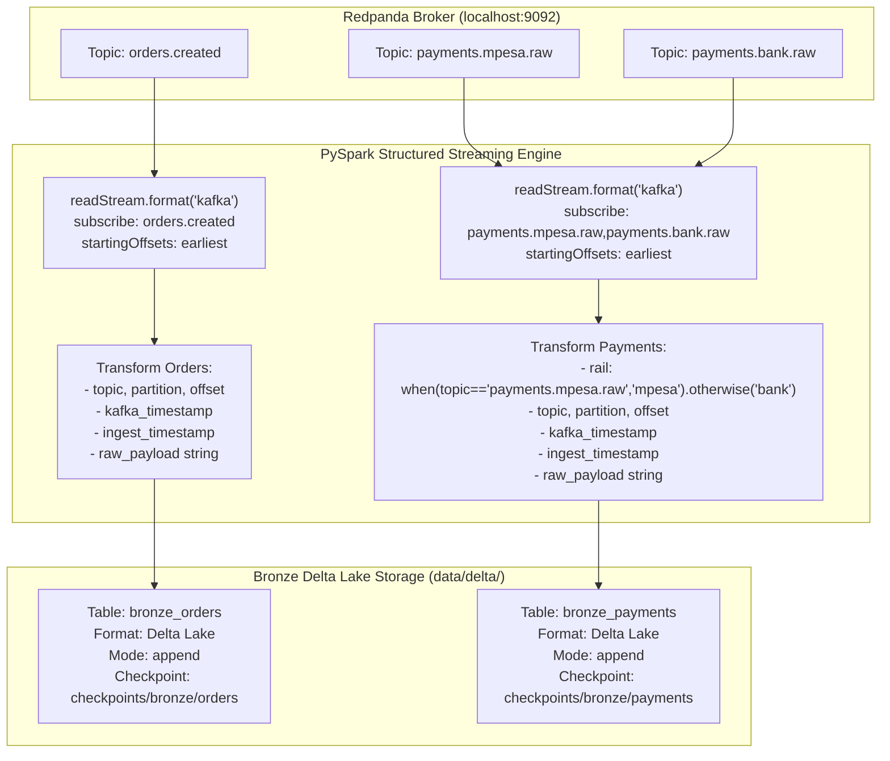

# Milestone 4: Bronze Streaming Append from Kafka to Delta Lake

## 1. Context & Objectives

The Bronze layer serves as the immutable single source of truth for the entire lakehouse. In financial reconciliation systems, bugs in parsing logic or changes in provider payload schemas are discovered months or years after transactions occur. If a lakehouse discards raw payloads or parses destructively at ingestion, raw evidence is permanently lost, making audit compliance and cold replays impossible.

The objective of **Milestone 4 (M4)** is to:
1. Connect PySpark Structured Streaming to Redpanda Kafka topics.
2. Ingest `orders.created`, `payments.mpesa.raw`, and `payments.bank.raw`.
3. Append raw payloads with rich transport metadata into Bronze Delta Lake tables (`bronze_orders` and `bronze_payments`) with fault-tolerant checkpointing.

---

## 2. Ingestion Architecture & Data Flow



---

## 3. Key Architectural Decisions

### Decision 1: Immutable Raw Payload Preservation (ADR 0003)
- The raw JSON bytes from Kafka are converted to an unparsed UTF-8 string column `raw_payload`.
- Neither malformed JSON syntax nor missing fields will ever cause the Bronze ingestion streaming query to crash or drop records.
- Even if Safaricom or a bank adds unexpected top-level fields, Bronze stores the raw bytes without schema evolution errors.

### Decision 2: Transport Metadata Extraction
Bronze captures vital transport provenance:
- `topic`: Source topic name.
- `partition`: Partition number (0, 1, or 2).
- `offset`: Continuous log sequence number.
- `kafka_timestamp`: Broker commit timestamp.
- `ingest_timestamp`: Micro-batch processing timestamp (`F.current_timestamp()`).

### Decision 3: Dynamic Kafka Package Dependency
- PySpark requires `org.apache.spark:spark-sql-kafka-0-10_2.12:3.5.1` to connect to Kafka.
- In `streaming/bronze.py`, `configure_spark_with_delta_pip(builder, extra_packages=KAFKA_PACKAGES)` injects the Kafka connector into Spark's Ivy resolver at session startup, maintaining zero external installation steps for developers.

### Decision 4: Execution Modes (`availableNow=True` vs Continuous)
- PySpark 3.3+ introduced `trigger(availableNow=True)`, which processes all pending data across multiple micro-batches until the stream catches up, then terminates cleanly.
- `streaming/bronze.py` supports both:
  - `--once` flag: Executes `trigger(availableNow=True)` for automated CI testing and scheduled cron runs.
  - Continuous mode: Keeps streaming queries active for real-time local testing.

---

## 4. Build Process Step-by-Step

1. **Bronze Ingestion Module (`streaming/bronze.py`)**:
   - `get_spark_session()` configured with Delta Lake and Kafka extensions.
   - `create_orders_stream()` and `create_payments_stream()` implementing column transformations.
   - `start_bronze_streaming()` starting checkpointed Delta writers.
2. **Schema Alignment (`streaming/common/schemas.py`)**:
   - Standardized `BRONZE_ORDERS_SCHEMA` and `BRONZE_PAYMENTS_SCHEMA`.
3. **End-to-End Integration Test (`tests/integration/test_bronze_streaming.py`)**:
   - Publishes orders, M-Pesa callbacks, and Bank settlements through the FastAPI edge receiver.
   - Runs `start_bronze_streaming(trigger_available_now=True)`.
   - Asserts Delta tables contain exact raw payloads and populated metadata.
   - Proves checkpoint idempotency: re-running with no new Kafka messages produces zero duplicate rows.

---

## 5. Verification & Proof of Done

Integration test execution against live Redpanda:
```bash
.venv/bin/pytest tests/integration/test_bronze_streaming.py
# Output:
# 1 passed in 29.26s
```
