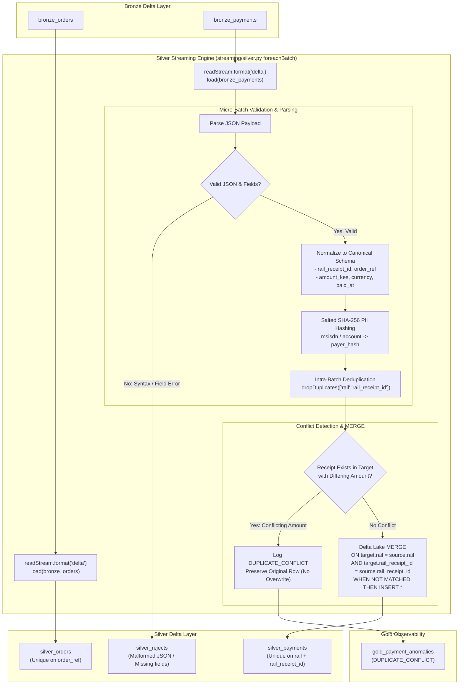

# Milestone 5: Silver Normalization, Deduplication MERGE & Rejects

## 1. Context & Objectives

The Silver layer is where raw, untrusted data is transformed into validated, normalized, and queryable financial records. In payment systems, external webhooks frequently redeliver identical payloads due to network timeouts, while customer PII (phone numbers and bank account numbers) must be sanitized before analytics access.

The objective of **Milestone 5 (M5)** is to:
1. Stream from Bronze Delta tables (`bronze_orders` and `bronze_payments`) using PySpark Structured Streaming with `foreachBatch`.
2. Parse and normalize heterogeneous payment formats (M-Pesa Daraja and core banking payloads) into a canonical payment schema.
3. Salt and hash customer PII using SHA-256.
4. Execute idempotent Delta Lake `MERGE` operations on `(rail, rail_receipt_id)` and `order_ref`, guaranteeing that duplicate deliveries never duplicate rows.
5. Preserve initial records upon duplicate conflicts and route anomalies to `gold_payment_anomalies`.
6. Route malformed or unparseable payloads to `silver_rejects` with actionable diagnostic reasons.

---

## 2. Silver Processing Pipeline Diagram



---

## 3. Key Architectural Decisions

### Decision 1: Delta MERGE over Watermark-Based dropDuplicates (ADR 0001)
- **Problem**: Spark Structured Streaming's native `dropDuplicates(["rail", "rail_receipt_id"])` requires an event-time watermark to evict state. If a gateway retries a webhook 3 days later (outside the 2-hour watermark window), the state is gone and the transaction is double-counted.
- **Solution**: We persist keys in Delta Lake and perform an idempotent `MERGE` inside `foreachBatch`:
  ```python
  (
      delta_target.alias("t")
      .merge(
          microbatch_df.alias("s"),
          "t.rail = s.rail AND t.rail_receipt_id = s.rail_receipt_id",
      )
      .whenNotMatchedInsertAll()
      .execute()
  )
  ```
- **Intra-Batch Safety**: If duplicate receipts arrive in the *same* micro-batch, `microbatch_df.dropDuplicates(["rail", "rail_receipt_id"])` strips duplicates before the initial Delta write.

### Decision 2: Duplicate Conflict Protection (No Blind Overwrites)
- If a receipt arrives a second time with a different amount (e.g. 2,000 KES first, then 3,500 KES):
  - Blind `whenMatchedUpdateAll()` is dangerous and could allow payment spoofing.
  - Rekon compares the existing amount against the incoming amount.
  - If `abs(incoming - existing) > 0.01`, the original row is preserved, and a `DUPLICATE_CONFLICT` anomaly is routed to `gold_payment_anomalies` capturing both amounts.

### Decision 3: Salted SHA-256 PII Masking (ADR 0005)
- Under the Kenyan Data Protection Act 2019 and GDPR, raw customer phone numbers (`2547XXXXXXXX`) and banking account numbers must not be stored in unmasked form in downstream analytical layers.
- Rekon hashes payer identifiers with a secret salt:
  ```python
  hashlib.sha256(f"{cleaned_identifier}:{salt}".encode()).hexdigest()[:24]
  ```
- This yields a deterministic, non-reversible 24-character pseudonym (`payer_hash`) enabling customer lifetime value analytics without exposing PII.

### Decision 4: Dead-Letter Queue in Silver (`silver_rejects`)
- Malformed payloads (corrupted JSON syntax, missing mandatory `TransID` or `BillRefNumber`) are never dropped.
- They are captured in `silver_rejects` along with:
  - Exact `raw_payload`.
  - Kafka partition and offset.
  - Diagnostic `reject_reason` (e.g. `"Expecting property name enclosed in double quotes"`).

---

## 4. Build Process Step-by-Step

1. **Deduplication Engine (`streaming/common/dedupe.py`)**:
   - `merge_silver_payments`: Intra-batch deduplication, conflict detection join, Delta MERGE.
   - `merge_silver_orders`: Intra-batch deduplication on `order_ref`, Delta MERGE.
2. **Silver Streaming Pipeline (`streaming/silver.py`)**:
   - `process_orders_microbatch()`: Parses JSON, extracts timestamps and amounts.
   - `process_payments_microbatch()`: Normalizes M-Pesa & Bank rails, hashes PII, routes rejects and conflicts.
   - `start_silver_streaming()`: Starts checkpointed `foreachBatch` streams with auto-initialization for empty Delta tables.
3. **Comprehensive Integration Test Suite (`tests/integration/test_silver_dedupe.py`)**:
   - `test_silver_dedupe_exact_duplicates`: Confirms 3 duplicate deliveries yield 1 Silver row and PII is hashed.
   - `test_silver_duplicate_conflict_detection`: Confirms conflicting amount preserves initial row and logs anomaly.
   - `test_silver_rejects_routing_for_malformed_payloads`: Confirms malformed payloads land in `silver_rejects`.
   - `test_silver_orders_deduplication`: Confirms idempotent order merging.

---

## 5. Verification & Proof of Done

Full Silver test suite execution:
```bash
.venv/bin/pytest tests/integration/test_silver_dedupe.py
# Output:
# 4 passed in 70.48s
```
