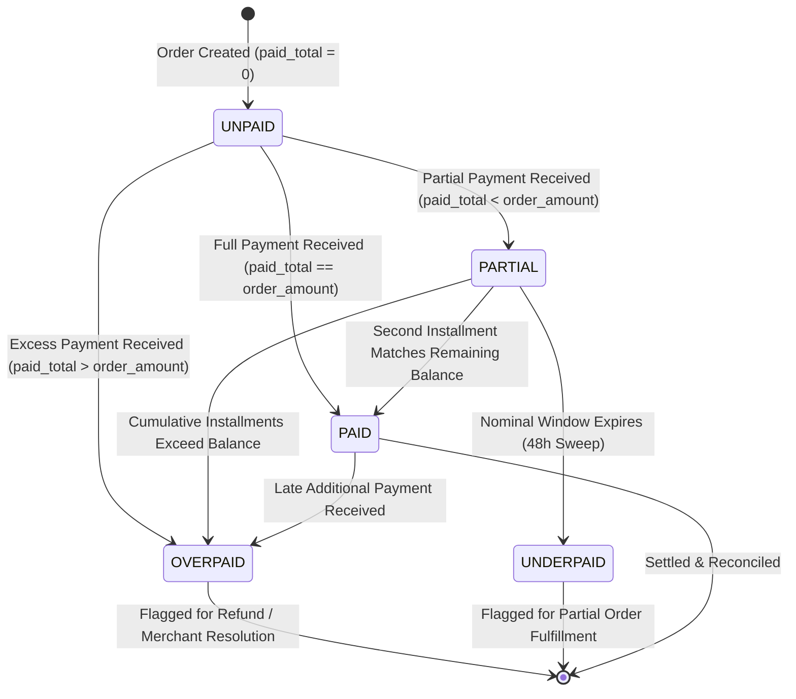
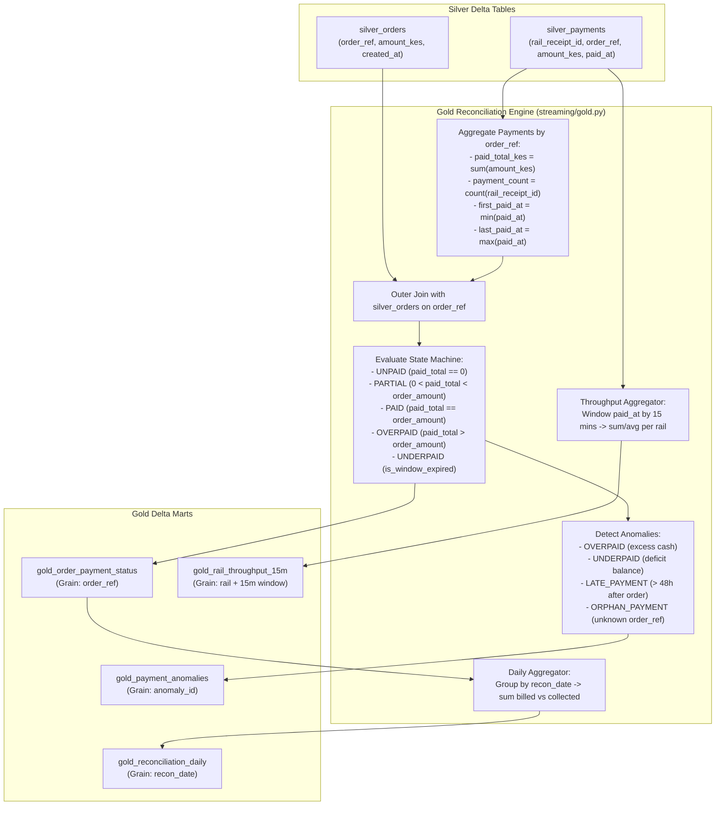

# Milestone 6: Gold Reconciliation & Anomaly Engine

## 1. Context & Objectives

The Gold layer transforms clean Silver transaction tables into verified financial ledgers, operational exceptions, and executive reporting marts. For digital commerce and POS operations in emerging markets, reconciliation must accurately reflect real-world customer settlement patterns:
- Multi-installment payments (split payments).
- Overpayments requiring merchant cash refunds.
- Abandoned carts and partial underpayments.
- Late settlements arriving outside nominal settlement windows.
- Payments referencing nonexistent orders (orphan payments).

The objective of **Milestone 6 (M6)** is to:
1. Implement the `OrderPaymentStatus` state machine in `streaming/gold.py`.
2. Generate `gold_order_payment_status` reconciling billed vs. collected funds per order.
3. Classify and route reason-coded operational exceptions into `gold_payment_anomalies`.
4. Aggregate executive cash summaries into `gold_reconciliation_daily`.
5. Compute 15-minute event-time tumbling window velocity metrics in `gold_rail_throughput_15m`.

---

## 2. Order Payment Status State Machine Diagram



---

## 3. Gold Mart Dataflow Architecture



---

## 4. Analytical Mart Specifications

### 4.1 Order Status Mart (`gold_order_payment_status`)
- **Grain**: One row per `order_ref`.
- **Primary Fields**:
  - `order_ref`: Unique order identifier (`ORD-xxxxxxxx`).
  - `shop_id`: Retail outlet / store location.
  - `order_amount_kes`: Billed order amount.
  - `paid_total_kes`: Cumulative verified funds collected across all rails.
  - `payment_count`: Number of distinct payments credited to this order.
  - `status`: Final state machine outcome (`UNPAID`, `PARTIAL`, `PAID`, `OVERPAID`, `UNDERPAID`).
  - `first_paid_at`: Earliest payment timestamp.
  - `last_paid_at`: Latest payment timestamp.
  - `settled_at`: Timestamp when order reached `PAID` state.
  - `last_updated_at`: Processing timestamp.

---

### 4.2 Anomalies Mart (`gold_payment_anomalies`)
- **Grain**: One row per detected anomaly.
- **Classification Rules**:

| Anomaly Type | Trigger Condition | Diagnostic Payload (`details`) |
| :--- | :--- | :--- |
| `OVERPAID` | `paid_total > order_amount` | `{"order_amount": 2000.0, "paid_total": 2500.0, "excess": 500.0}` |
| `UNDERPAID` | Window expired & `0 < paid_total < order_amount` | `{"order_amount": 5000.0, "paid_total": 3500.0, "deficit": 1500.0}` |
| `LATE_PAYMENT` | `last_paid_at > order_created_at + 48h` | `{"paid_at": "...", "order_created_at": "..."}` |
| `ORPHAN_PAYMENT` | Payment `order_ref` not found in `silver_orders` | `{"amount_kes": 800.0, "paid_at": "..."}` |
| `DUPLICATE_CONFLICT` | Same receipt redelivered with different amount | `{"existing_amount": 2000.0, "conflicting_amount": 3500.0}` |

---

### 4.3 Daily Reconciliation Mart (`gold_reconciliation_daily`)
- **Grain**: One row per calendar date (`recon_date`).
- **Summary Metrics**:
  - `billed_amount_kes`: Total invoice volume billed to customers.
  - `collected_amount_kes`: Total liquid funds verified in bank / M-Pesa accounts.
  - `billed_orders_count`, `paid_orders_count`, `partial_orders_count`, `unpaid_orders_count`, `overpaid_orders_count`, `underpaid_orders_count`.

---

### 4.4 Rail Throughput Mart (`gold_rail_throughput_15m`)
- **Grain**: One row per `(rail, window_start, window_end)`.
- **Summary Metrics**:
  - `transaction_count`: Transaction velocity in 15-minute event-time window.
  - `total_amount_kes`: Cash volume processed per rail.
  - `avg_amount_kes`: Average ticket size per rail.

---

## 5. Verification & Proof of Done

Full Gold integration test suite ([`tests/integration/test_gold_reconciliation.py`](../../tests/integration/test_gold_reconciliation.py)):
- Verified multi-installment payments transition `PARTIAL` to `PAID` with correct `settled_at` timestamp.
- Verified overpayments and late payments flag `OVERPAID` and `LATE_PAYMENT` anomalies.
- Verified orphan payments referencing unknown orders are routed to `gold_payment_anomalies`.
- Verified 48-hour sweep transitions lingering partial orders to `UNDERPAID` and updates `gold_reconciliation_daily`.
- Verified 15-minute event-time window grouping in `gold_rail_throughput_15m`.

```bash
.venv/bin/pytest tests/integration/test_gold_reconciliation.py
# Output:
# 3 passed in 80.75s
```
