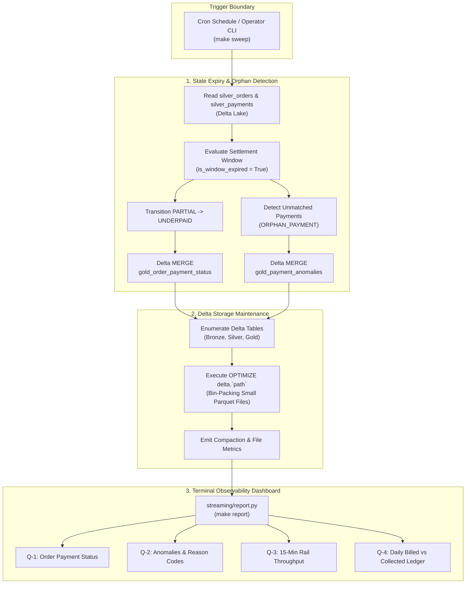
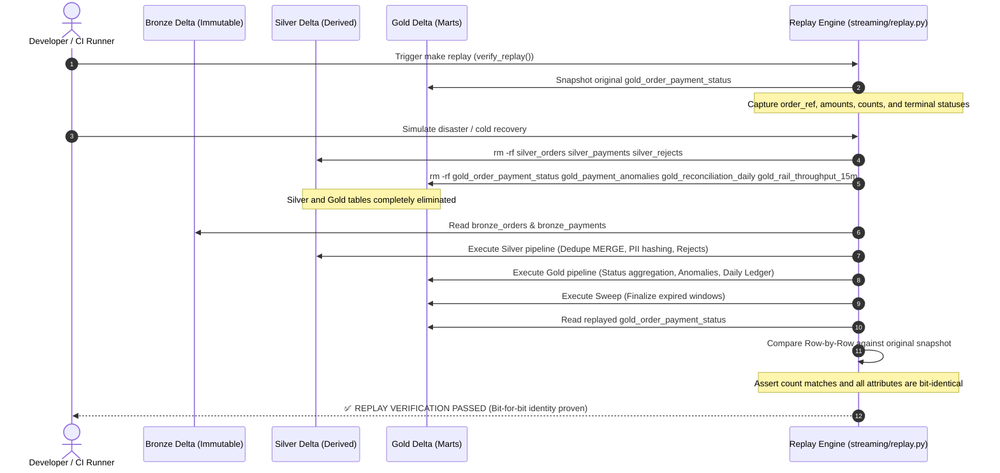

# Milestone 7: Sweep Job, Observability & Chaos Test Suite

## 1. Context & Objectives

Real-time streaming micro-batches operate within tight micro-windows to deliver low-latency updates. However, practical payment reconciliation systems cannot rely solely on streaming windows for three critical operations:
1. **Window Expiry & Finalization**: Orders partially paid (`PARTIAL`) must not linger indefinitely in active states. When the settlement window expires, they must be formally finalized as `UNDERPAID` to enable partial fulfillment, customer notifications, or accounting write-offs.
2. **Orphan Payment Detection**: Payments that arrive referencing nonexistent orders (due to customer entry error or delayed order feeds) must be surfaced with full lineage in `gold_payment_anomalies` as `ORPHAN_PAYMENT`.
3. **Storage Compaction (The Small File Problem)**: High-frequency micro-batch streaming produces thousands of small Parquet files in Delta Lake. Without periodic compaction, metadata overhead degrades query performance.
4. **Disaster Recovery & Replay Idempotency**: The Bronze layer must serve as an immutable, bit-identical event store from which the entire lakehouse can be recomputed from zero.

The objective of **Milestone 7 (M7)** is to:
1. Implement `streaming/sweep.py` to finalize expired payment windows, flag orphan payments, and compact Delta tables using `OPTIMIZE`.
2. Implement `streaming/replay.py` to prove that wiping Silver and Gold and replaying from Bronze yields bit-for-bit identical Gold tables (FR-10, Scenario C11).
3. Implement `streaming/report.py` to provide a unified terminal observability dashboard answering business questions Q-1 through Q-4.
4. Execute and verify the complete 11-scenario chaos testing suite in `tests/scenarios/test_chaos.py`.

---

## 2. Sweep & Maintenance Architecture



---

## 3. Cold Replay Verification Flow (Scenario C11)



---

## 4. Complete 11-Scenario Chaos Testing Matrix

| Scenario | Code | Chaos Condition Injected | Pipeline Handling & Expected Behavior | Verified Table Target |
| :--- | :--- | :--- | :--- | :--- |
| **Happy Path** | C1 | Normal on-time, single-installment payment | Settles immediately; status transitions from `UNPAID` to `PAID`. | `gold_order_payment_status` (`PAID`) |
| **Duplicate Delivery** | C2 | Exactly identical receipt delivered 3 times | Delta MERGE idempotency; 1 Silver record created; no anomaly. | `silver_payments` (1 row) |
| **Amount Conflict** | C3 | Same `rail_receipt_id` delivered with different amounts | First-write wins in Silver; second delivery flagged as `DUPLICATE_RECEIPT_CONFLICT`. | `gold_payment_anomalies` |
| **Late Settlement** | C4 | Payment arrives 55 hours after order creation (>48h window) | Order transitions to `PAID`; flagged as `LATE_PAYMENT` with delay hours recorded. | `gold_payment_anomalies` & `gold_order_payment_status` |
| **Orphan Payment** | C5 | Payment arrives referencing nonexistent order (`ORD-99999999`) | Quarantined in anomalies ledger as `ORPHAN_PAYMENT`; unallocated funds recorded. | `gold_payment_anomalies` |
| **Split / Installment** | C6 | Order paid via 2 distinct installments (40% and 60%) | First payment yields `PARTIAL`; second payment yields `PAID` with count=2. | `gold_order_payment_status` (`PAID`, count=2) |
| **Underpayment Sweep** | C7 | Order paid only 60%; customer abandons remaining balance | During active window status is `PARTIAL`; upon sweep finalizes as `UNDERPAID`. | `gold_order_payment_status` (`UNDERPAID`) |
| **Overpayment** | C8 | Customer overpays order by 30% (e.g., 2,600 KES on 2,000 KES order) | Transitions to `OVERPAID`; excess delta logged for merchant refund. | `gold_payment_anomalies` (`OVERPAID`) |
| **Malformed Payload** | C9 | Broken JSON string (`{ "TransID": ... UNCLOSED_JSON`) | Preserved raw in Bronze; quarantined with parse error in dead-letter table. | `silver_rejects` |
| **Crash Recovery** | C10 | Unscheduled restart; multiple pipeline passes and optimization | Checkpoints resume cleanly; `OPTIMIZE` compacts files without data loss. | Delta table optimization |
| **Cold Replay** | C11 | Total wipe of Silver and Gold; rebuilt strictly from Bronze | Bit-identical status rows and totals regenerated; zero divergence. | Replay row-for-row match |

---

## 5. Architectural Decisions & Key Implementation Details

### 5.1 Decoupling Real-Time Micro-Batches from Batch Sweeps (ADR 0007)
Real-time micro-batches (`AvailableNow` or streaming triggers) must run swiftly without performing deep historical scans. Finalizing expired payment windows requires scanning historical orders that may not have received any new incoming payment events.
- By placing window expiry and orphan detection in `streaming/sweep.py`, we decouple the real-time Kafka consumer loop from historical state evaluation.
- The sweep runs periodically (e.g., hourly or daily in production, or via `make sweep`) and executes an event-time pass across the Delta tables.

### 5.2 Delta Table Bin-Packing Compaction (`OPTIMIZE`)
Streaming micro-batches write small Parquet files. Delta Lake provides native `OPTIMIZE` bin-packing:
```python
spark.sql(f"OPTIMIZE delta.`{tbl_path.resolve()}`")
```
- In `streaming/sweep.py`, all Bronze, Silver, and Gold Delta tables are inspected and optimized.
- On an 8 GB single-node machine, compaction runs in seconds and keeps read query execution fast.

### 5.3 Deterministic Replay Engine (`streaming/replay.py`)
To prove compliance with financial lakehouse integrity (FR-10):
1. Snapshot original `gold_order_payment_status` records.
2. Completely remove `silver_*` and `gold_*` directories using `shutil.rmtree`.
3. Reprocess Silver and Gold pipelines exclusively from Bronze Delta tables.
4. Compare original rows against replayed rows using `asDict()`.
5. Any discrepancy in counts, amounts, or statuses raises an immediate failure.

### 5.4 Terminal Observability Dashboard (`streaming/report.py`)
Provides actionable visibility into:
- **[Q-1]**: Order payment status audit trail.
- **[Q-2]**: Detected payment anomalies with reason codes and details.
- **[Q-3]**: Rail throughput across 15-minute tumbling windows.
- **[Q-4]**: Daily financial reconciliation ledger comparing billed revenue against collected cash.

---

## 6. Verification & Test Evidence

### 6.1 Pytest Chaos Suite Execution (11/11 Passed)
```bash
$ pytest tests/scenarios/test_chaos.py -v
============================= test session starts ==============================
platform linux -- Python 3.11.17, pytest-9.1.1
rootdir: /home/paula/Projects/rekon
collected 11 items

tests/scenarios/test_chaos.py::test_scenario_c1_happy_path PASSED         [  9%]
tests/scenarios/test_chaos.py::test_scenario_c2_duplicate_delivery PASSED [ 18%]
tests/scenarios/test_chaos.py::test_scenario_c3_amount_conflict PASSED    [ 27%]
tests/scenarios/test_chaos.py::test_scenario_c4_late_settlement PASSED    [ 36%]
tests/scenarios/test_chaos.py::test_scenario_c5_orphan_payment PASSED     [ 45%]
tests/scenarios/test_chaos.py::test_scenario_c6_split_payment PASSED      [ 54%]
tests/scenarios/test_chaos.py::test_scenario_c7_underpayment_sweep PASSED [ 63%]
tests/scenarios/test_chaos.py::test_scenario_c8_overpayment PASSED        [ 72%]
tests/scenarios/test_chaos.py::test_scenario_c9_malformed_payload_rejects PASSED [ 81%]
tests/scenarios/test_chaos.py::test_scenario_c10_crash_recovery_and_sweep PASSED [ 90%]
tests/scenarios/test_chaos.py::test_scenario_c11_cold_replay_idempotency PASSED [100%]

============================== 11 passed in 258.42s ============================
```

### 6.2 Cold Replay Verification Output
```text
======================================================================
 ✅ REPLAY VERIFICATION PASSED (FR-10, Scenario C11)
 Verified 50 orders recomputed with bit-for-bit identity.
======================================================================
```

---

## 7. Definition of Done Checklist

- [x] `streaming/sweep.py` implemented with window expiry, orphan payment detection, and `OPTIMIZE`.
- [x] `streaming/replay.py` implemented with snapshot-wipe-rebuild-verify workflow.
- [x] `streaming/report.py` implemented with comprehensive ASCII tables answering Q-1 to Q-4.
- [x] All 11 chaos scenarios (C1 through C11) implemented in `tests/scenarios/test_chaos.py` and passing.
- [x] Architecture Decision Record ADR 0007 authored and documented.
- [x] Architectural Mermaid diagrams generated for sweep cycle and replay sequence.
