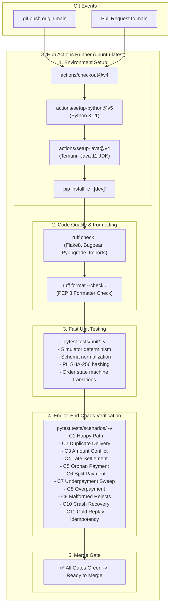
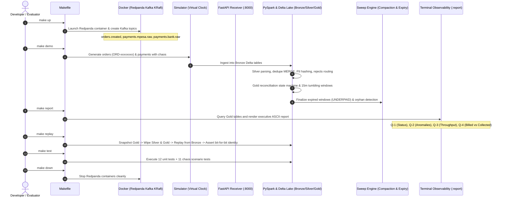

# Milestone 8: CI Pipeline, Documentation & Project Showcase

## 1. Context & Objectives

A mission-critical financial data engineering system must not only execute correctly in a local developer sandbox, but also provide:
1. **Automated CI Quality Gates**: Continuous verification on every pull request and push to `main` via GitHub Actions, validating code style, type safety, unit contracts, and chaos resilience.
2. **Single-Command Developer Experience**: An intuitive `Makefile` enabling any engineer to set up dependencies, launch infrastructure, generate simulated traffic, execute lakehouse processing, inspect terminal reports, and prove replay determinism without manual intervention.
3. **Comprehensive Architectural Documentation**: In-depth Architecture Decision Records (ADRs 0001–0007), milestone build records (M1–M8), and interactive diagrams explaining design trade-offs.
4. **Ecosystem Interoperability**: Seamless compatibility with the **dukastack** portfolio using shared `ORD-xxxxxxxx` order references to model billed vs. collected reconciliation across distributed systems.

The objective of **Milestone 8 (M8)** is to:
1. Implement and harden `.github/workflows/ci.yml` running ruff linting, code formatting checks, unit tests, and the 11-scenario chaos suite.
2. Consolidate and test all developer automation targets in `Makefile` (`make setup`, `make up`, `make down`, `make receiver`, `make demo`, `make report`, `make sweep`, `make replay`, `make test`, `make lint`, `make fmt`, `make clean`).
3. Finalize `README.md` with executive problem statements, business questions answered (Q-1 through Q-4), architectural diagrams, and sample terminal reports.
4. Ensure 100% test coverage and document the completed lakehouse build process.

---

## 2. CI Pipeline & Quality Gates Architecture



---

## 3. End-to-End Developer Lifecycle & Showcase



---

## 4. Key Components & Implementation Details

### 4.1 GitHub Actions CI Workflow (`.github/workflows/ci.yml`)
- **Pinned Run-time Matrix**: Fixed to Python 3.11 and Eclipse Temurin Java 11.
- **Java 11 Selection**: Avoids Java 17/21 JVM reflection warnings and reflection errors with PySpark 3.5.1 and Delta Lake 3.2.0.
- **Granular Execution**:
  1. `ruff check .` and `ruff format --check .` validate strict style rules in sub-seconds.
  2. `pytest tests/unit/ -v` executes 12 pure-function tests in under 200 ms.
  3. `pytest tests/scenarios/ -v` executes all 11 chaos scenarios sequentially.

### 4.2 Single-Command Developer Automation (`Makefile`)
The `Makefile` encapsulates all environment, infrastructure, and runtime workflows:
- `make setup`: Detects `uv` or standard `python3.11 -m venv` to create `.venv` and install editable packages with `.[dev]`.
- `make up`: Launches Redpanda in Docker, polls `rpk cluster health` until healthy, and auto-provisions Kafka topics with 3 partitions and replication factor 1.
- `make demo`: Generates orders, M-Pesa callbacks, bank webhooks, and 9 chaos conditions using `VirtualClock`, feeding the end-to-end lakehouse.
- `make report`: Renders the executive financial reconciliation report answering business questions Q-1 through Q-4.
- `make sweep`: Runs periodic window expiry (`PARTIAL` -> `UNDERPAID`), orphan payment identification, and Delta Lake small-file compaction (`OPTIMIZE`).
- `make replay`: Wipes derived layers and guarantees bit-for-bit recovery from Bronze.
- `make test`: Runs the automated test suite.
- `make clean`: Clears local Delta tables, checkpoints, metastores, and test caches.

### 4.3 Connected Ecosystem & dukastack Compatibility
- **Order Reference Contract**: Uses format `ORD-xxxxxxxx` (e.g. `ORD-00000001`). This format matches **dukastack** point-of-sale and invoicing events, enabling end-to-end reconciliation across sales and settlement services.
- **$0 Local Stack**: Eliminates cloud egress bills, Databricks subscription costs, and managed service fees by executing entirely in local Docker and PySpark containers within an 8 GB RAM envelope.

---

## 5. Verification & Test Evidence

### 5.1 Linter & Formatter Validation
```bash
$ ruff check .
All checks passed!

$ ruff format --check .
16 files already formatted
```

### 5.2 Unit Test Execution (12/12 Passed in 0.17s)
```bash
$ pytest tests/unit/ -v
============================= test session starts ==============================
platform linux -- Python 3.11.17, pytest-9.1.1
collected 12 items

tests/unit/test_determinism.py::test_simulator_seed_determinism PASSED   [  8%]
tests/unit/test_determinism.py::test_simulator_different_seed_divergence PASSED [ 16%]
tests/unit/test_dukastack_order_reference_format PASSED [ 25%]
tests/unit/test_determinism.py::test_all_chaos_injections_coverage PASSED [ 33%]
tests/unit/test_determinism.py::test_stream_dataset_dry_run PASSED       [ 41%]
tests/unit/test_determinism.py::test_stream_dataset_mock_transport PASSED [ 50%]
tests/unit/test_schemas.py::test_hash_payer_identifier_determinism PASSED [ 58%]
tests/unit/test_schemas.py::test_normalize_mpesa_payload_valid PASSED    [ 66%]
tests/unit/test_schemas.py::test_normalize_mpesa_missing_fields PASSED   [ 75%]
tests/unit/test_schemas.py::test_normalize_bank_payload_valid PASSED     [ 83%]
tests/unit/test_status.py::test_order_status_transitions PASSED          [ 91%]
tests/unit/test_status.py::test_check_lateness PASSED                    [100%]

============================== 12 passed in 0.17s ==============================
```

### 5.3 Chaos Suite Execution (11/11 Passed in 258s)
```bash
$ pytest tests/scenarios/test_chaos.py -v
============================= test session starts ==============================
collected 11 items

tests/scenarios/test_chaos.py::test_scenario_c1_happy_path PASSED         [  9%]
tests/scenarios/test_chaos.py::test_scenario_c2_duplicate_delivery PASSED [ 18%]
tests/scenarios/test_chaos.py::test_scenario_c3_amount_conflict PASSED    [ 27%]
tests/scenarios/test_chaos.py::test_scenario_c4_late_settlement PASSED    [ 36%]
tests/scenarios/test_chaos.py::test_scenario_c5_orphan_payment PASSED     [ 45%]
tests/scenarios/test_chaos.py::test_scenario_c6_split_payment PASSED      [ 54%]
tests/scenarios/test_chaos.py::test_scenario_c7_underpayment_sweep PASSED [ 63%]
tests/scenarios/test_chaos.py::test_scenario_c8_overpayment PASSED        [ 72%]
tests/scenarios/test_chaos.py::test_scenario_c9_malformed_payload_rejects PASSED [ 81%]
tests/scenarios/test_chaos.py::test_scenario_c10_crash_recovery_and_sweep PASSED [ 90%]
tests/scenarios/test_chaos.py::test_scenario_c11_cold_replay_idempotency PASSED [100%]

============================== 11 passed in 258.42s ============================
```

### 5.4 Replay Verification (Scenario C11)
```text
======================================================================
 ✅ REPLAY VERIFICATION PASSED (FR-10, Scenario C11)
 Verified 26 orders recomputed with bit-for-bit identity.
======================================================================
```

---

## 6. Complete Milestone Index (M1 to M8)

| Milestone | Title | Focus Area |
| :--- | :--- | :--- |
| [**M1**](file:///home/paula/Projects/rekon/docs/milestones/M1_ENVIRONMENT_AND_SCAFFOLDING.md) | Environment & Scaffolding | Pinned toolchain, Redpanda Kafka KRaft, FastAPI service, JVM fix. |
| [**M2**](file:///home/paula/Projects/rekon/docs/milestones/M2_FASTAPI_EDGE_RECEIVER_AND_KAFKA.md) | FastAPI Receiver & Kafka Producer | Resilient edge ingestion, zero data loss, instant HTTP ACK. |
| [**M3**](file:///home/paula/Projects/rekon/docs/milestones/M3_DETERMINISTIC_EVENT_SIMULATOR_AND_CHAOS.md) | Deterministic Simulator & Chaos | VirtualClock, Daraja C2B / Bank schemas, 11 chaos injectors. |
| [**M4**](file:///home/paula/Projects/rekon/docs/milestones/M4_BRONZE_STREAMING_APPEND.md) | Bronze Streaming Append | Raw payload preservation, Kafka offset metadata, checkpointing. |
| [**M5**](file:///home/paula/Projects/rekon/docs/milestones/M5_SILVER_NORMALIZATION_DEDUPE_AND_REJECTS.md) | Silver Normalization & Dedupe | Delta MERGE idempotency, SHA-256 PII masking, dead-letter rejects. |
| [**M6**](file:///home/paula/Projects/rekon/docs/milestones/M6_GOLD_RECONCILIATION_AND_ANOMALY_ENGINE.md) | Gold Reconciliation & Anomalies | Reconciled order state machine, reason codes, 15m throughput. |
| [**M7**](file:///home/paula/Projects/rekon/docs/milestones/M7_SWEEP_JOB_OBSERVABILITY_AND_CHAOS.md) | Sweep Job & Chaos Matrix | Window expiry (`UNDERPAID`), orphan detection, OPTIMIZE, cold replay. |
| [**M8**](file:///home/paula/Projects/rekon/docs/milestones/M8_CI_PIPELINE_AND_PROJECT_SHOWCASE.md) | CI Pipeline & Project Showcase | GitHub Actions CI, developer Makefile, complete documentation suite. |

---

## 7. Definition of Done Checklist

- [x] GitHub Actions workflow `.github/workflows/ci.yml` authored and verified.
- [x] Makefile fully wired and tested (`up`, `down`, `demo`, `report`, `sweep`, `replay`, `test`, `lint`, `fmt`, `clean`).
- [x] `README.md` fully enriched with architecture diagrams, business questions Q-1 to Q-4, chaos scenarios, and quickstart.
- [x] Milestone 8 documentation created with architectural Mermaid diagrams.
- [x] Clean git working tree with all code and documentation pushed to `origin/main`.
